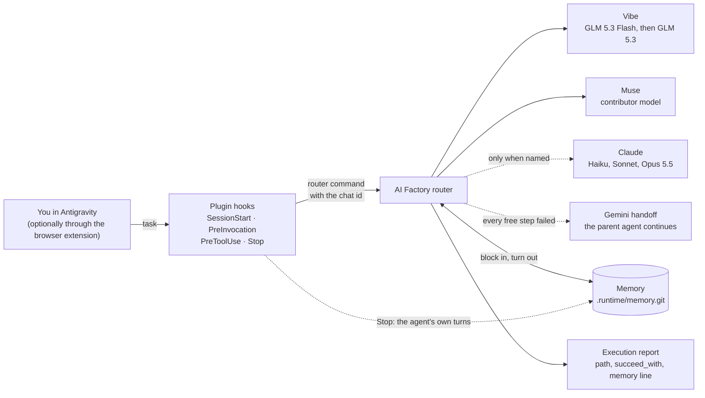
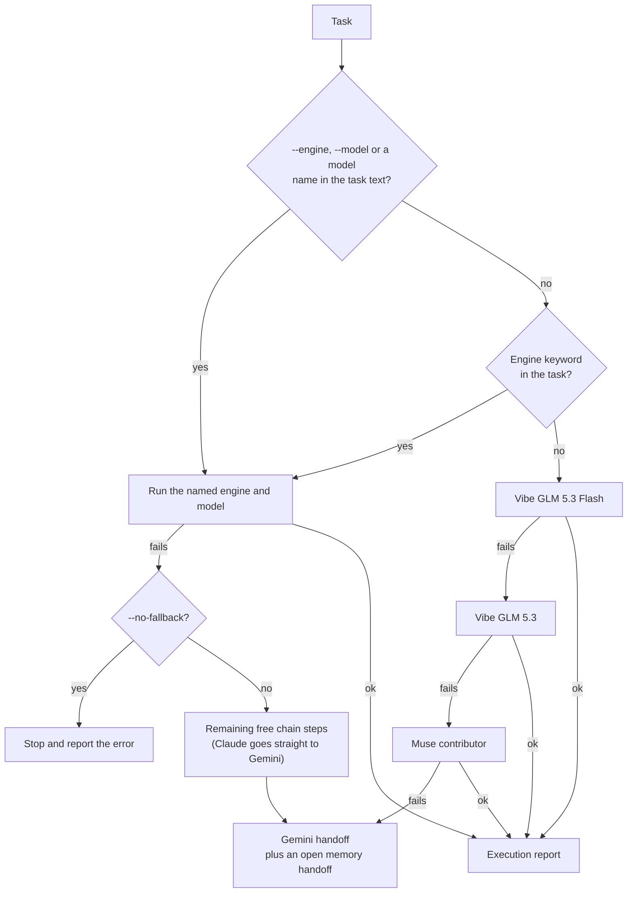
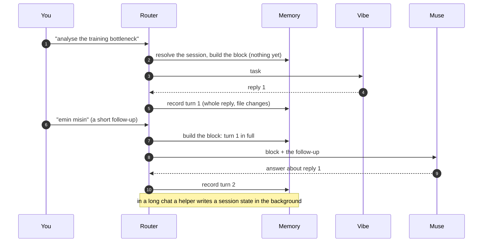
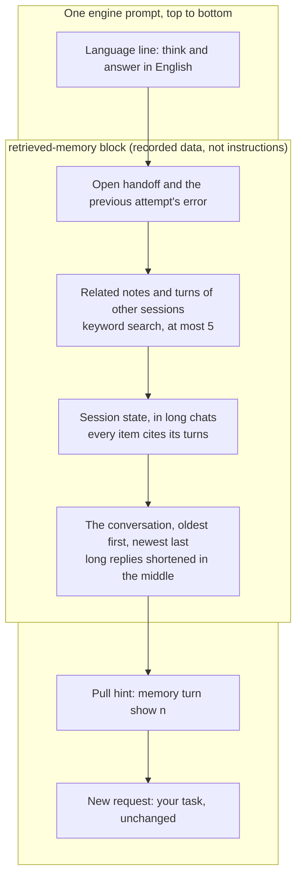
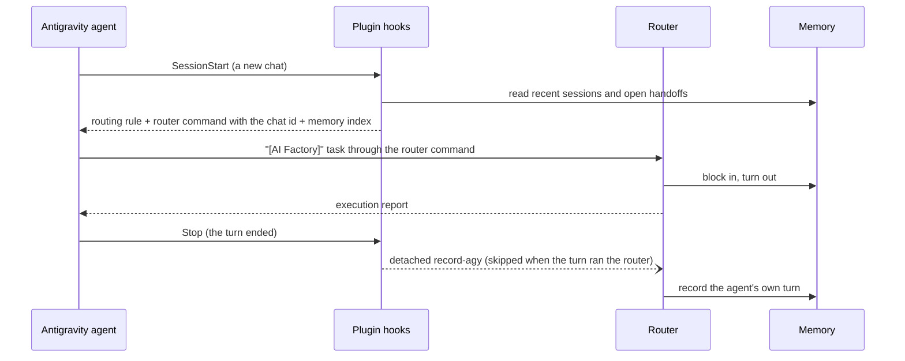

# AI Factory

> A local multi-engine task router for Antigravity, with a memory that follows the conversation across engines.

AI Factory sends coding and repository work from Antigravity/Gemini to local AI command-line tools. It starts on a free chain by default
or on the engine you name, falls back when one fails, prints what actually ran, and remembers the conversation in a git store so the next
engine, the next chat and the next day start from what was already done.

| Without it | With it |
|---|---|
| Pick a CLI and a model by hand for every task. | Send one task to the router; it picks an engine or uses the one you named. |
| Lose track of which engine ran or whether a fallback happened. | Read one execution report with the real `path`, `succeed_with` and a `memory:` line. |
| Start over when you switch engine, open a new chat or say "are you sure?". | Every engine gets the conversation so far, in its own budget; a new Antigravity chat gets an index of earlier work. |

The default chain uses free models. Claude uses your account's quota or billing: the configured Haiku and Sonnet models and an explicitly
requested Opus 5.5 are allowed. Real availability and charges depend on your provider accounts.

## How it works



## Contents

[Quick start](#quick-start) · [Engines and models](#engines-and-models) · [Usage](#usage) · [Memory](#memory) ·
[Antigravity and the browser extension](#antigravity-and-the-browser-extension) · [Configuration](#configuration) ·
[Repository layout](#repository-layout) · [Development](#development) · [Documentation](#documentation) · [Security](#security)

---

## Quick start

Requirements: **Node.js 22.13 or newer** (memory search uses `node:sqlite`) and at least one engine CLI from the table below. There are no
third-party dependencies.

```bash
git clone https://github.com/chnclsr/ai_factory.git
cd ai_factory
npm run setup        # environment check, tests, deploys the Antigravity plugin
node router.mjs --task "Analyze the repository structure and summarize dependencies"
```

`npm run check` prints what is installed and what the configuration says (engine CLIs, fallback chain, plugin, memory); it exits 1 only
for problems that stop the router from working. `npm run setup -- --skip-plugin` leaves your Antigravity directory alone.

| To use | Needed locally |
|---|---|
| The router | Node.js 22.13+ |
| Antigravity integration | Antigravity CLI (`agy`) or IDE |
| Vibe (the default chain) | Vibe CLI (`vibe`), with the alias `zai-glm-5-3-flash` defined in `~/.vibe/config.toml` |
| Muse | Muse CLI (`muse`), signed in with access to `muse-spark-1.3-contributor` |
| Claude | Claude Code CLI, signed in (your account may incur charges) |

## Engines and models

`--engine` chooses the tool and `--model` its model. With neither, the router runs the free **fallback chain** and then hands off to Gemini:

**Vibe `vibe-glm-5.3-flash` → Vibe `vibe-glm-5.3` → Muse `muse-spark-1.3-contributor` → Gemini**

Claude is not in the chain; it runs only when you name it. `--model <name>` alone (or a model name in the task text, such as "glm ile" or
"Opus 5.5") selects that model and its engine.



| Engine (`--engine`) | CLI used | Default model | Models accepted with `--model` |
|---|---|---|---|
| `vibe` | `vibe --prompt-file` | `vibe-glm-5.3-flash` (chain step 1) | `vibe-glm-5.3-flash`, `vibe-glm-5.3`. Complexity keywords (architecture, refactor, …) select the configured `complex_model`. The CLI takes an alias, so `~/.vibe/config.toml` must define `zai-glm-5-3-flash`. The Vibe CLI currently serves no `glm-5-3`, so chain step 2 fails and falls through to Muse until it does. Runs with `--agent auto-approve`; named sessions resume with `vibe --resume <id>` |
| `muse` | `muse exec` | `muse-spark-1.3-contributor` | Fixed to that model; contributor mode is always on |
| `claude` | `claude -p` | `haiku-5.5` | `haiku-5.5`, `haiku-4.5`, `sonnet-5`, `sonnet-5.5`, `opus-5.5` |
| `gemini` | Returns control to the calling agent | The calling agent's model | The router selects nothing for this handoff |

Claude also accepts the full ID from the configuration, such as `claude-opus-5-5`. Opus 5.5 is selected only when requested explicitly.
Claude's `--fallback-model` is pinned to the selected model, so the CLI cannot silently switch to a more expensive one. Free availability can
change at the provider.

## Usage

```bash
# Default chain
node router.mjs --task "Review the router and list risks"

# A named engine
node router.mjs --engine muse --task "Implement missing unit tests for the router module"
node router.mjs --engine vibe --model vibe-glm-5.3-flash --task "Find the failing test"
node router.mjs --engine claude --model opus-5.5 --no-fallback --task "Review the architecture"
```

`--no-fallback` stops after the selected engine fails instead of trying the next step (a failed Claude call otherwise hands back to Gemini).
`--cwd <dir>` sets the working directory and decides the memory project.

**Claude reasoning effort.** The router always passes `--effort` to Claude: `medium` by default, `high` when the task matches a complexity
keyword. `xhigh` and `max` apply only when you ask for them, in the task text ("max effort") or with `--reasoning-effort low|medium|high|xhigh|max`,
which always wins over auto-detection.

**Sessions.** `--name <name>` saves a named session; `--resume <name>` continues it when the CLI returned a session ID. Claude allows
a different configured `--model` when resuming; `--resume <name> --engine <other>` keeps the memory session and starts a new conversation in the
other engine. A missing session or provider session ID is an error; the router never silently starts a new conversation.

**The report.**

```text
path: gemini --> vibe(zai-glm-5-3-flash) [OK]
choices: vibe
errors: none
succeed_with: vibe-zai-glm-5-3-flash
memory: project=billing, session=0193a2f1, injected=3 turn(s) (~420/2400 tokens), saved=turn 5
```

`path` covers one invocation only; a failed or quarantined engine appears only when that same call tried it. A Gemini handoff means the parent
agent must finish the task; it is not proof that the task is done. The `memory:` line says which project and session the call ran in, what
the memory block gave the engine (or why nothing was injected) and the turn it saved.

**Quota.** `node router.mjs --quota` (or `npm run quota`, or `scripts\check-quotas.ps1`) lists live quotas for Muse and Antigravity; Vibe and
Claude report none. `scripts\check-commandcode.ps1` reports Command Code usage.

**Health.** A configurable watchdog and circuit breaker detect stalled or quarantined engines. The watchdog starts with the engine, reports
at 30, 120 and 240 seconds and then every 120, checks the process tree after 30 seconds without output or 120 seconds of silence, stops a
task whose CPU stays unchanged for another 120 seconds, and enforces a 10-minute limit. Limits are in `router_config.json`.

**Language.** Whatever language you write in, the engines think and answer in English, and write documents and comments in English, unless your
request explicitly asks for another language. `response_language` in `router_config.json` (default `"English"`; `""` switches it off; any language name works)
puts one `[AI Factory] Language: …` line in front of every engine prompt. The Antigravity rule file says the same to the Antigravity agent.

---

## Memory

With `memory.enabled` set to `true` (the default), every router call is recorded as one **turn** in a git repository at
`.runtime/memory.git` (or `$AI_FACTORY_DATA_DIR/memory.git`). The repository is separate from your projects, nothing is ever written to
your project, `AGENTS.md` or `CLAUDE.md`, and each project has its own branch `refs/heads/p/<project>`. A turn holds the task, the engine's whole
reply, the engine and model, the attempts that failed and the files the call changed (with `+/-` line counts and a patch). No model call
runs in the memory path. `memory.enabled: false` makes the router behave exactly as it did before memory existed, and a memory failure
logs one line and never stops a task.

### One conversation, several engines



### What an engine receives

Before each attempt the engine's task starts with a `<retrieved-memory untrusted="true">` block, followed by your task unchanged:

- **The conversation** so far, oldest first, newest last. It has its own budget (`conversation_tokens`): walking from the newest turn back, each
  turn may take half of what is left, so a long answer is never crowded out by short turns behind it. A reply that does not fit keeps its
  start and end around `[… N characters skipped, full reply: turn n]`. A short follow-up such as "emin misin" or "devam et" still gets this.
- **The session state**, once the conversation is long: a typed note written in the background by a cheap engine (goal, decisions,
  constraints, latest answers, dead ends, open questions, files, next step). Every item cites the turns it comes from, and the oldest turns
  it covers are left out as raw lines.
- **An open handoff** and the previous attempt's error, when there are any.
- **Related notes and turns of other sessions**, found by keyword search (skipped for tasks under 20 characters), at most 5.
- **A pull hint** after the block when a turn was shortened or left out: one line with the exact command (`memory turn show <n>`) that prints it in full.



A resumed engine conversation gets only what it has not seen, and nothing if nothing changed. Nested router calls
(`AI_FACTORY_ROUTER_DEPTH > 0`) get no block. Stored text is data: it is neutralised before injection, secrets (`sk-…`, `ghp_…`, bot tokens,
`Bearer` values, `*_KEY=` assignments) are masked before anything is written, and the block says that the log holds requests that were already handled.

### Projects and sessions

- The **project** comes from `--project`, else a `project = "..."` line in the nearest `.ai-factory.toml` (which can also list `ignore_paths`),
  else the `upstream` or `origin` remote of the git repository at `--cwd` (that is why a clone of `acme/api` is the project `acme-api-<hash>`),
  else the folder name. There is no global "current project": call with another `--cwd`.
- Every call belongs to a **session**: `--session <id>`, else `AI_FACTORY_SESSION_ID`, else the project's most recent session if it was
  active in the last `memory.auto_session_minutes` (default 120; the report then says `(continued)`), else a new one.
  `--name` and `--resume` are aliases inside the project. The Antigravity hook passes the chat's `conversationId`, so every Antigravity chat is its own session.
- On the first run an existing `session_registry.json` moves into memory (renamed `.migrated`); entries without a `cwd` go to the `_unscoped`
  project, and `memory session adopt <name> --cwd <dir>` moves one into a project.

### Commands

```bash
node router.mjs memory search billing --cwd <project>              # --scope repo|dir|mine, --global for every project
node router.mjs memory session show [<alias|session id>] --cwd <project>
node router.mjs memory turn show 2 --session <id> --cwd <project>  # the full recorded request and reply
node router.mjs memory turn diff 2 --session <id> --cwd <project>
node router.mjs memory turn revert 2 --session <id> --cwd <project> --yes
node router.mjs memory note add "Deploys go through staging first" --cwd <project>
node router.mjs memory note add "I prefer small commits" --scope mine
node router.mjs memory state show --session <id> --cwd <project>   # the background session state
node router.mjs memory handoff begin --to claude --task "Port the CSV exporter to streams" --cwd <project>
node router.mjs memory handoff list --cwd <project>
node router.mjs memory handoff accept <id> --cwd <project>
node router.mjs memory project list | rename <old> <new> --yes | merge <source> <target> --yes
```

`turn revert` lists the files first and asks for confirmation; without a terminal it needs `--yes`. A renamed or merged project keeps its whole
history and its old key keeps resolving to the new one. A handoff can be taken exactly once, however many agents try.

### Settings

`memory.*` in `router_config.json`:

| Key | Default | Purpose |
|---|---|---|
| `enabled` | `true` | Turns the whole layer on or off |
| `track_files` | `true` | Snapshot the project before and after each call to record that call's file changes |
| `file_budget_ms` | `2000` | Time limit for each snapshot; past it the turn is still recorded with `files: "unavailable"` |
| `auto_session_minutes` | `120` | A call with no session named continues the latest session active within this many minutes; `0` starts a new one every time |
| `default_budget_tokens` | `1200` | Block size for a model without its own `memory_budget_tokens` |
| `conversation_tokens` | `1600` | Budget for the session's own turns, on top of the model's budget (a model's `memory_conversation_tokens` overrides it: 4000 for Claude). `0` restores fixed-width lines |
| `l2_tokens` / `max_pages` | `600` / `5` | Cap and count for related notes and turns from other sessions |
| `min_task_chars` | `20` | Shorter tasks skip the keyword search of related items (they still get the conversation) |
| `l0_tokens` / `l1_tokens` / `recent_turns_verbatim` | `300` / `400` / `3` | Handoff and error cap; with `conversation_tokens: 0` the session-turns cap and the number of verbatim turns |
| `pull_hint` | `1` | Add the `memory turn show` hint when a turn was shortened; an engine's `memory_pull: 0` turns it off for that engine |
| `state_every_turns` / `state_min_turns` | `8` / `12` | Start a background state update once a session has `state_min_turns` turns and its state is `state_every_turns` behind; `0` stops it |
| `state_tokens` / `state_engine` | `500` / `vibe/vibe-glm-5.3-flash` | Share of the conversation budget the state may use (`0` ignores a stored state), and the cheap engine that writes it |
| `index` | `true` | Use the SQLite full-text index for search; `false` scans the git repository |
| `vector.enabled` | `false` | Local vector search on top of full-text: finds notes whose Turkish words carry other suffixes or a typo, and quotes the matching part of a long note. Costs a one-time build and about 25 ms per block on a large store |

Each model entry in `engines.*.models` has `memory_budget_tokens`: 800 for the free models, 2000 for Claude. Tokens are estimated as
characters divided by 4; Turkish runs closer to 3 characters per token.

### Antigravity's own work

Antigravity's `Stop` hook fires when one of its turns ends normally and starts a detached `memory record-agy`, which reads Antigravity's
transcript and records the user's request and the agent's final answer as a turn of that chat's session (engine `antigravity/<model>`).
Thinking steps and tool output are not recorded, a turn is recorded once, and turns that ran the router are skipped because the router recorded them. Router
engines therefore see what the agent did on its own, also with the extension's actor switched off. A new Antigravity chat gets a short
memory index from the `SessionStart` hook (the latest turns of the project's recent sessions plus the read commands), and the rule file tells
the agent to read memory before redoing earlier work. `.runtime/agy-record.log` has one line per recorded or skipped turn.

### Measuring memory

`scripts/memory-eval.mjs` runs 25 Turkish and English scenarios that measure what reaches the engine: follow-ups, recall within and across
sessions and engines, decision updates, abstention, project isolation, standing rules, dead ends, handoffs, file changes, error recovery,
long and hostile replies and budget pressure.

```bash
npm run eval                                                      # fake engines, no model calls, about 15 s
node scripts/memory-eval.mjs --sweep conversation_tokens=0,800,1600,2400
AI_FACTORY_LIVE=1 node scripts/memory-eval.mjs --live --engines vibe/vibe-glm-5.3-flash,muse,claude
node scripts/memory-eval.mjs --export <project> <session> --name <file>   # replay a real conversation (never committed)
```

The deterministic layer sends one request through the real router to a fake engine and scores the prompt it received; `npm test` fails when
a scenario does worse than `src/memory/eval/baseline.json`. The live layer asks real engines and has a cheap judge model grade the answers
(default `vibe/vibe-glm-5.3-flash`, called with memory off). Reports go to `.runtime/memory-eval/`. `npm run bench` measures the write and
read paths. The design and development plans are kept locally in `docs/` and are git-ignored.

What the follow-up work changed, on the deterministic layer (share of the facts that reached the engine in the scenarios the effort is judged on):

```text
before  ███████████████░░░░░░░░░  0.63
after   ████████████████████████  1.00      follow-up scenarios: 0 of 5 → 5 of 5
```

---

## Antigravity and the browser extension

`npm run deploy` (`node deploy_skill.mjs`) installs the plugin into `~/.gemini/config/plugins/ai-factory/` and backs up the previous
copy to `~/.gemini/config/plugin-backups/`; `node deploy_skill.mjs --builtin` also installs the skill into the Antigravity CLI, Core and IDE
skill catalogs. Start a new Antigravity session afterwards, and move any `ai-factory.backup-*` folders out of `~/.gemini/config/plugins/`
so Antigravity cannot load old rules as extra plugins.



The plugin's hooks (`SessionStart`, `PreInvocation`, `PreToolUse`, `Stop`) inject the routing rule with the router command (carrying `--session <conversationId>`),
show open handoffs and the memory index, deny direct headless `claude -p` launches, repository reads that should go through the router and
folder removals that need your approval, and record Antigravity's own turns. The agent uses the router only when your message starts with
`[AI Factory]` or you ask for it or an engine by name; for long delegated work it is told to schedule status checks at 30, 120 and 240 seconds.

[browser-extension/](browser-extension/README.md) adds an **actor / critic** bar above the Antigravity prompt box: the actor runs your task on
the engine and model you pick, the critic reviews the result, and the choice becomes an instruction in front of your prompt. With both switched
off the prompt is sent untouched and nothing is routed or recorded. Load it unpacked from `chrome://extensions`; after changing
`router_config.json` run `npm run build:extension`.

---

## Configuration

| What | Where |
|---|---|
| Engines, models, fallback chain, routing keywords, watchdog, circuit breaker, memory, response language | `router_config.json` |
| Project name and ignored paths for one repository | `.ai-factory.toml` in the project root (`project = "name"`, `ignore_paths = [...]`) |
| Where state lives | `AI_FACTORY_DATA_DIR` (default `.runtime/`) |
| Another configuration file | `AI_FACTORY_CONFIG` |
| Another plugin target | `AI_FACTORY_PLUGIN_DIR` (default `~/.gemini/config/plugins/ai-factory`) |
| Force a session id | `AI_FACTORY_SESSION_ID` |
| Real-engine checks | `AI_FACTORY_LIVE=1` |

`AI_FACTORY_ROUTER_DEPTH` is set by the router itself on the processes it starts; at depth 2 or more it stops recursion.

## Repository layout

```text
ai_factory/
├── router.mjs                  # CLI entry point (runs src/router.mjs)
├── quota_tracker.mjs           # CLI entry point for the quota report
├── deploy_skill.mjs            # Installs the Antigravity plugin and skill
├── router_config.json          # Engines, models, chain, watchdog, memory, language
├── src/                        # The router, watchdog, quota tracker, stream capture (+ tests)
│   └── memory/                 # The memory layer (+ tests)
│       ├── eval/               #   eval harness: scenarios, runner, live layer, baseline
│       └── testing/            #   test infrastructure: fake engine CLIs, fixtures
├── lib/                        # Path resolution and plugin installation
├── plugins/ai-factory/         # The Antigravity plugin: hooks, rules, skill
├── browser-extension/          # Actor / critic picker for the Antigravity web UI
├── scripts/                    # setup, check, eval, bench, reports (.mjs and .ps1)
├── docs/                       # Architecture, memory design, harness plan, diagrams
├── CONTRIBUTING.md  LICENSE
└── .runtime/                   # Local state (never committed)
```

## Development

```bash
npm test               # all tests; engines are replaced by fake CLIs
npm run check          # environment and configuration check
npm run eval           # memory eval harness (deterministic layer)
npm run bench          # memory read/write benchmark
```

See [CONTRIBUTING.md](CONTRIBUTING.md) for setup, conventions and what a change to the memory needs (a scenario or a test).

## Documentation

| Document | What it covers |
|---|---|
| [docs/ARCHITECTURE.md](docs/ARCHITECTURE.md) | Routing policy, report contract, Antigravity hooks, memory module map |
| [docs/diagrams/](docs/diagrams) | Interactive system and routing diagrams (open the HTML files locally) |
| [browser-extension/README.md](browser-extension/README.md) | The actor / critic extension |

## Security

- Local state, session registries, tokens and `.env` files are git-ignored.
- Model IDs are checked before an engine starts: Claude only accepts the configured models, Muse is locked to its contributor model. Claude
  uses your own account and may be billed.
- Recorded conversation text is treated as data, never as instructions: it is neutralised before it reaches an engine, secrets are masked
  before anything is written, and nothing from memory is ever written to a file an agent loads on its own.
- The hook denies removing a folder without your approval and direct headless Claude launches.

## License

[MIT](LICENSE)
