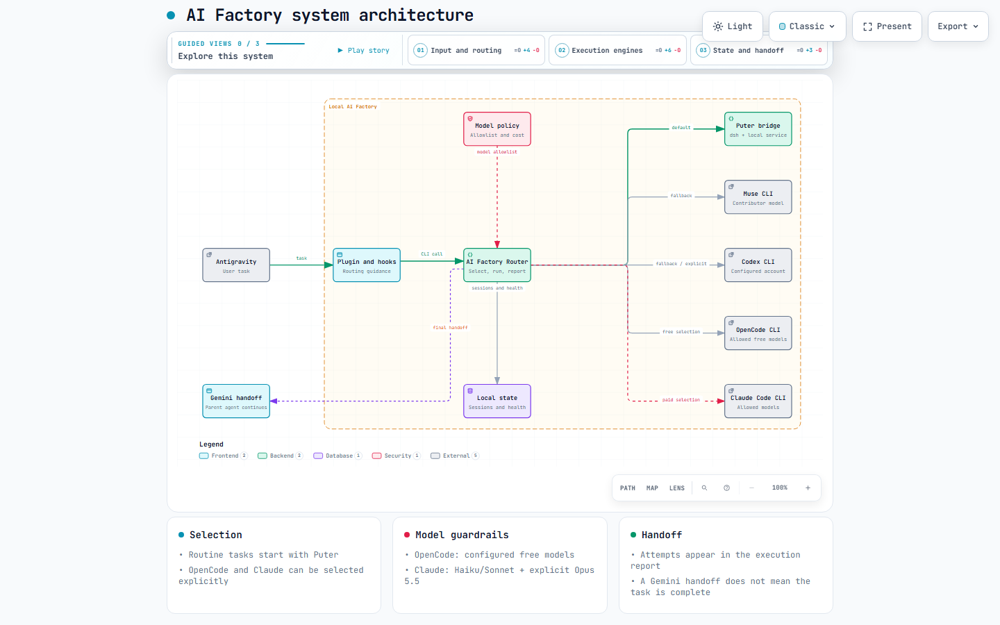
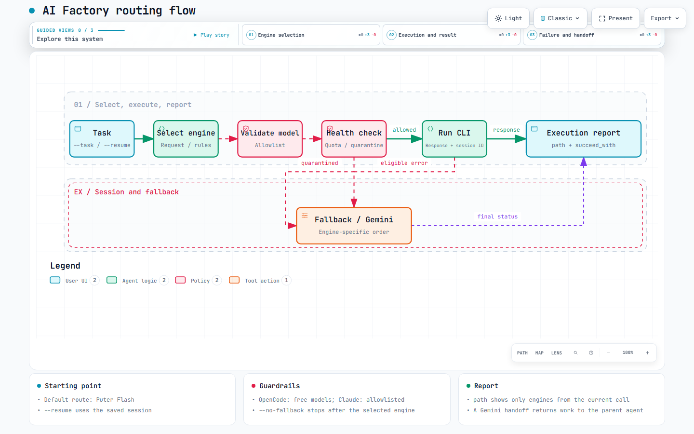

# AI Factory

> **Smart Token Offloading and Multi-Engine Orchestrator for Antigravity**

AI Factory routes coding and repository work from Antigravity/Gemini to local AI CLIs. You can let it choose a starting engine or name OpenCode, Claude, Muse, Puter, or Codex yourself. It records what actually ran and can continue a saved CLI session.

| Before | After |
|---|---|
| Pick a CLI and model by hand for every task. | Send one task to the router; it selects an engine or uses the one you named. |
| Lose track of which engine ran or whether a fallback happened. | Read one execution report with the actual `path` and `succeed_with`. |
| Start over on a follow-up. | Save a named session and resume it when that CLI returns a session ID. |

OpenCode is restricted to the free models in [router_config.json](router_config.json). Claude uses your account's quota or billing: configured Haiku/Sonnet models and explicitly requested Opus 5.5 are allowed. Actual availability and charges depend on your provider account.

---

## What You Get

| Feature | What it does |
|---|---|
| Smart routing | Starts routine tasks with Puter Flash; explicit requests can select OpenCode, Claude, Muse, or Codex. |
| Model guardrails | Rejects paid OpenCode IDs and unlisted Claude models; Opus 5.5 requires an explicit request. |
| Claude delegation check | The Antigravity hook rejects direct headless Claude launches from terminal tools and directs the agent to the router; help and authentication checks remain available. |
| Engine-specific fallback | Puter, Muse, and Codex have their own fallback order; OpenCode/Claude hand back to Gemini rather than trying another paid engine. |
| Named sessions | `--name` stores a session; `--resume` continues it when the CLI supplied an ID. |
| Execution report | `path` lists only engines attempted in **this** router call; `succeed_with` names the successful engine or Gemini handoff. |
| Health checks | Configurable watchdog and circuit breaker detect stalled or quarantined engines. `--quota` checks Puter, Muse, Codex, and Antigravity, not OpenCode/Claude. |
| AGY task checks | For long delegated work, the plugin instructs AGY to schedule status checks at 30, 120, and 240 seconds, then every 120 seconds until the task ends, when its in-turn timer tool is available. |

AGY is instructed to inspect actual progress while a long task runs. If its timer tool supports `TimerCondition`, AGY is instructed to use `never` so progress messages do not cancel checks. The router starts its task watchdog as soon as an engine launches and prints a start notice. It reports whether the engine process is alive at 30, 120, and 240 seconds, then every 120 seconds while it runs. After 30 seconds without initial output, or 120 seconds of later silence, it also checks the engine and its child processes. If their CPU use stays unchanged for another 120 seconds, it stops the task. Every task has a 10-minute limit, even if output continues; if CPU information is unavailable, that limit still applies. Adjust these limits in `router_config.json`.

## Tools and Models

`--engine` chooses the tool; `--model` chooses its model. The table shows the default when you select that tool without a model. With no tool selected, routing rules start routine tasks with Puter `flash` and select Puter `pro` for configured complexity keywords.

| Tool (`--engine`) | CLI used | Default model | Model names accepted with `--model` |
|---|---|---|---|
| Puter (`puter`) | `dsh headless` through the local bridge | `flash` | `flash`, `pro`; see the Puter model note below |
| Muse (`muse`) | `muse exec` | `muse-spark-1.3-contributor` | Fixed to `muse-spark-1.3-contributor`; contributor mode is always enabled |
| Codex (`codex`) | `codex exec` | `gpt-6.1-sol` | `gpt-6-luna`, `gpt-5.6-luna`, `gpt-6.1-sol`, `gpt-6-sol`, `gpt-5.6-terra`, `gpt-5.6-sol`, `gpt-5.5`, `gpt-6-astra` |
| OpenCode (`opencode`) | `opencode run` | `deepseek-v4.1-flash-free` | The 12 configured free models listed below |
| Claude Code (`claude`) | `claude -p` | `haiku-5.5` | `haiku-5.5`, `haiku-4.5`, `sonnet-5`, `sonnet-5.5`, `opus-5.5` |
| Gemini / Antigravity (`gemini`) | Returns control to the calling agent | The calling agent's current model | The router does not select a new model for this handoff |

For example, to run Claude Opus 5.5 and stop if it fails:

```bash
node router.mjs --engine claude --model opus-5.5 --no-fallback --task "Review the architecture"
```

OpenCode and Claude also accept the full model IDs from [router_config.json](router_config.json), such as `opencode/mimo-v2.6-flash-free` or `claude-opus-5-5`. Claude Opus 5.5 is selected only when requested explicitly. Codex also forwards other model IDs to its CLI; your account must support them. Muse always uses its fixed contributor model, even if another model is requested.

<details>
<summary>All 12 configured OpenCode models</summary>

Use any of these names with `--engine opencode --model <name>`:

- `deepseek-v4.1-flash-free` (default)
- `mimo-v2.6-flash-free`
- `muse-spark-1.3-contributor-free`
- `mimo-v2.5-free`
- `nemotron-3-ultra-free`
- `nemotron-3.5-lightning-free`
- `longcat-2.5-preview-free`
- `step-5-preview-free`
- `exo-free`
- `space-bunny-free`
- `cat-jam-free`
- `big-pickle`

Paid OpenCode models are rejected by the router.

</details>

**Puter model selection:** `flash` uses the model already configured in DeepSeek Harness (`dsh`). `pro` applies the bundled [pro-patch.yml](pro-patch.yml), which selects `deepseek-reasoner`. The configuration also lists `r1`, but the launcher has no separate R1 override: `--model r1` follows the default `dsh` path and does not guarantee an R1 request.

These are the router's configured choices. Availability, quota, and charges depend on your provider account. See [Usage](#usage) for examples for each tool.

## Architecture

[Interactive system diagram HTML](docs/diagrams/ai-factory-architecture.html) · [Interactive routing flow HTML](docs/diagrams/ai-factory-routing.html) · [Architecture notes](docs/ARCHITECTURE.md)





The Antigravity plugin adds routing guidance; the local router selects a CLI, applies model and health checks, records sessions, and prints the result. A Gemini handoff means the parent agent must finish the task—it is not proof that the task is complete. Both diagrams and their interactive viewer controls are in English.
GitHub shows the PNG previews above; download either HTML file and open it locally for search, focus views, and theme switching.

---

## Directory Structure

```text
ai_factory/
├── router.mjs                 # Main CLI entry point
├── server.mjs                 # Puter RPC and local bridge service
├── quota_tracker.mjs          # Multi-provider quota inspection utility
├── check_quotas.ps1           # PowerShell quota check runner
├── deploy_skill.mjs           # Distribution script for global Antigravity dirs
├── router_config.json         # Engine models and watchdog parameters
├── docs/
│   ├── ARCHITECTURE.md         # Routing policy and report semantics
│   └── diagrams/              # Interactive architecture and workflow diagrams
├── src/                       # Core implementation modules
│   ├── router.mjs
│   ├── server.mjs
│   └── quota_tracker.mjs
├── lib/                       # Path resolution and plugin utilities
│   ├── paths.mjs
│   └── plugin.mjs
├── scripts/
│   └── setup.mjs              # Environment initialization
└── plugins/ai-factory/        # Global Antigravity Plugin
    ├── plugin.json            # Plugin manifest
    ├── hooks.json             # Event hooks (PreInvocation, PreToolUse)
    ├── hooks/
    │   ├── hook_handler.js    # Context protection and auto-delegation hook
    │   └── inject.js          # System prompt injection helper
    ├── rules/
    │   ├── AGENTS.md          # Global agent rules and watchdog protocol
    │   ├── GEMINI.md          # Gemini synchronization rules
    │   └── ai_factory_router.md
    └── skills/ai-factory/
        └── SKILL.md           # Antigravity skill specification
```

---

## Installation and Deployment

### Prerequisites

| To use | Required locally |
|---|---|
| AI Factory | Node.js 22 or newer (`package.json` requirement) |
| Antigravity integration | Antigravity CLI (`agy`) or Antigravity IDE |
| OpenCode tasks | OpenCode CLI installed and signed in to a provider with the selected free model |
| Claude tasks | Claude Code CLI installed and signed in; your account may incur charges |
| Puter tasks | DeepSeek Harness (`dsh`) installed and configured, plus an authenticated local Puter bridge: start it with `npm start`, then open `http://127.0.0.1:8080` to sign in |
| Muse tasks | Muse CLI (`muse`) installed and signed in with access to `muse-spark-1.3-contributor` |
| Codex tasks | Codex CLI (`codex`) installed and signed in with access to the requested model |

| Install step | Command | Result |
|---|---|---|
| Dependencies | `npm install` | Installs the local Puter bridge dependency. |
| Global Antigravity plugin | `node deploy_skill.mjs` | Installs plugin, hooks, and rules. |
| Native CLI/IDE skill catalog | `node deploy_skill.mjs --builtin` | Also adds the built-in AI Factory skill where the host catalog exists. |

### Setup
1. Clone the repository:
   ```bash
   git clone https://github.com/chnclsr/ai_factory.git
   cd ai_factory
   ```

2. Install dependencies:
   ```bash
   npm install
   ```

### Deploying Globally to Antigravity

AI Factory provides `deploy_skill.mjs` to automatically wire the plugin, rules, hooks, and built-in skills across Antigravity runtime environments.

#### 1. Standard Plugin Deployment
Installs the global plugin, event hooks, and orchestrator rules:
```bash
node deploy_skill.mjs
```
Target directory:
- `~/.gemini/config/plugins/ai-factory/`
  - `plugin.json` and `hooks.json` (Windows hooks use a launcher that handles spaces in installation paths)
  - `hooks/hook_handler.js` (intercepts heavy context calls and delegates to router)
  - `rules/AGENTS.md` and `rules/GEMINI.md` (active system rules for Antigravity)

#### 2. Builtin Skill Deployment (CLI and IDE Native Discovery)
To allow Antigravity CLI and Antigravity IDE to discover and index `ai_factory` directly in their native built-in skill catalogs, run with the `--builtin` flag:
```bash
node deploy_skill.mjs --builtin
```
This distributes the skill specification (`SKILL.md`) to all existing host catalogs:
- `~/.gemini/antigravity-cli/builtin/skills/ai_factory/SKILL.md` (Antigravity CLI)
- `~/.gemini/antigravity/builtin/skills/ai_factory/SKILL.md` (Antigravity Core)
- `~/.gemini/antigravity-ide/builtin/skills/ai_factory/SKILL.md` (Antigravity IDE)

When executed, existing files are automatically backed up with a timestamp suffix before being updated.
Plugin backups are stored in `~/.gemini/config/plugin-backups/`, outside the active plugin directory. Older installs may have `ai-factory.backup-*` folders inside `~/.gemini/config/plugins/`; move those folders to `plugin-backups/` so Antigravity cannot load their old rules as extra plugins. Start a new Antigravity session after updating the plugin.

---

## Usage

### Default Code/Repo Delegation (0$ Puter Flash)
```bash
node router.mjs --task "Analyze the repository structure and summarize dependencies"
```

### Deep Reasoning Mode (Puter Pro)
```bash
node router.mjs --engine puter --model pro --task "Optimize algorithmic complexity for the core pipeline"
```

### Meta Muse Agent (0$ Contributor Mode)
```bash
node router.mjs --engine muse --task "Implement missing unit tests for the router module"
```

### OpenAI Codex Engine
```bash
node router.mjs --engine codex --model gpt-6.1-sol --task "Produce architectural refactoring roadmap"
```

### OpenCode Free Models
```bash
node router.mjs --engine opencode --model deepseek-v4.1-flash-free --name review --task "Review the router"
node router.mjs --engine opencode --model mimo-v2.6-flash-free --task "Find the failing test"
```
Change `--model` to another free model listed in `router_config.json`. Paid OpenCode model IDs are rejected. Free availability can change at the provider.

### Claude Code
```bash
node router.mjs --engine claude --model haiku-5.5 --name draft --task "Summarize this repository"
node router.mjs --engine claude --model sonnet-5.5 --task "Review the router"
node router.mjs --engine claude --model opus-5.5 --no-fallback --task "Review the architecture"
```
Claude Code must already be signed in. These models use your Claude account's quota or billing. Opus 5.5 is available with `--engine claude --model opus-5.5` (or `--model claude-opus-5-5`); a task that explicitly names "Opus 5.5" also selects it. Other Opus versions and Fable are excluded. `--no-fallback` stops after a Claude failure instead of handing the task back to Gemini.

`haiku-5.5` is the configured default. Only the five Claude entries in `router_config.json` are accepted; a model's presence in the config does not guarantee access on your account. The router keeps Claude's `--fallback-model` on the same selected model, so the Claude CLI cannot silently switch to a more expensive model.

### Resuming Previous Session
```bash
node router.mjs --resume "session-name" --task "Continue refactoring"
node router.mjs --resume "review" --model mimo-v2.6-flash-free --task "Now inspect the tests"
```
OpenCode and Claude allow a different configured `--model` when resuming. A missing session or a missing provider session ID is reported as an error; the router does not silently start a new conversation.

### Reading the Report
```text
path: gemini --> opencode(opencode/deepseek-v4.1-flash-free) [OK]
succeed_with: opencode-opencode/deepseek-v4.1-flash-free
```
`path` covers one invocation only. If you called the router twice, the second report will not include engines tried by the first call. A failed or quarantined engine is included only when that same call attempted it.

### Live Quota Status Check
```bash
node router.mjs --quota
```
Or via PowerShell:
```powershell
.\check_quotas.ps1
```

---

## Security

- Authentication tokens (`puter_token.txt`) and session registries are listed in `.gitignore` to prevent credential exposure.
- Muse integration is hard-locked to `muse-spark-1.3-contributor`, preventing accidental charges from billed models.
- OpenCode and Claude model IDs are checked before either CLI starts. Claude still uses your own account and may be billed.

---

## License
MIT License
